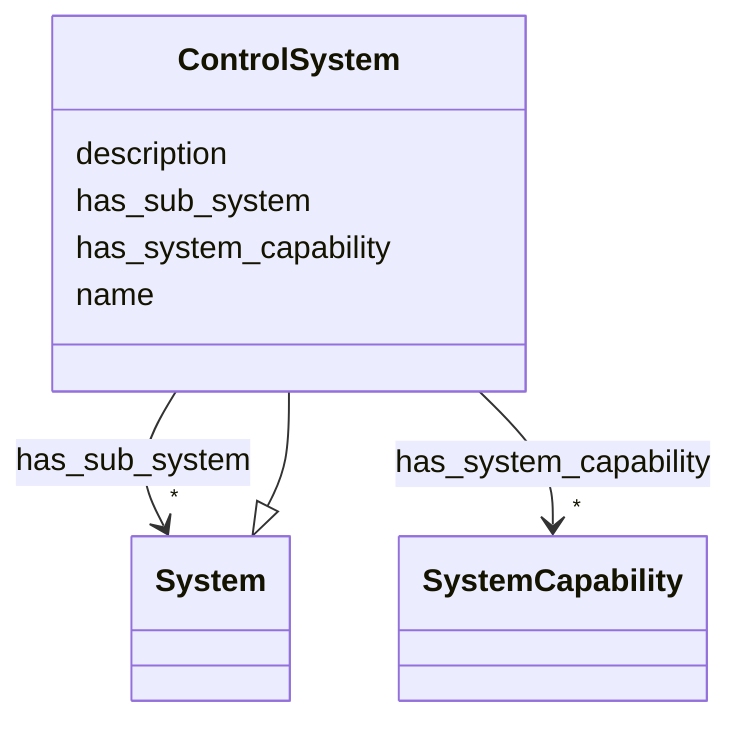

# Class: ControlSystem 


_A control system (e.g. EPICS) that manages device process variables. In the SSN graph a ControlSystem is a subsystem of the Facility._

__


URI: [narad:ControlSystem](https://w3id.org/narad_linkml/schema/narad/ControlSystem)





## Inheritance
* [NamedThing](NamedThing.md)
    * [System](System.md)
        * **ControlSystem**


## Slots

| Name | Cardinality and Range | Description | Inheritance |
| ---  | --- | --- | --- |
| [has_sub_system](has_sub_system.md) | * <br/> [System](System.md) | Relates a System to one of its subsystems (SSN alignment) | [System](System.md) |
| [has_system_capability](has_system_capability.md) | * <br/> [SystemCapability](SystemCapability.md) | Relates a System to a SystemCapability it supports (SSN-System alignment) | [System](System.md) |
| [name](name.md) | 1 <br/> [String](String.md) | Human-readable name or local string key for the entity | [NamedThing](NamedThing.md) |
| [description](description.md) | 0..1 <br/> [String](String.md) | Detailed description of the entity | [NamedThing](NamedThing.md) |


## Identifier and Mapping Information


### Schema Source


* from schema: https://w3id.org/narad_linkml/schema/narad/system


## Mappings

| Mapping Type | Mapped Value |
| ---  | ---  |
| self | narad:ControlSystem |
| native | narad:ControlSystem |
| exact | ssn:System |


## LinkML Source

<!-- TODO: investigate https://stackoverflow.com/questions/37606292/how-to-create-tabbed-code-blocks-in-mkdocs-or-sphinx -->

### Direct

<details>
```yaml
name: ControlSystem
description: 'A control system (e.g. EPICS) that manages device process variables.
  In the SSN graph a ControlSystem is a subsystem of the Facility.

  '
from_schema: https://w3id.org/narad_linkml/schema/narad/system
exact_mappings:
- ssn:System
is_a: System

```
</details>

### Induced

<details>
```yaml
name: ControlSystem
description: 'A control system (e.g. EPICS) that manages device process variables.
  In the SSN graph a ControlSystem is a subsystem of the Facility.

  '
from_schema: https://w3id.org/narad_linkml/schema/narad/system
exact_mappings:
- ssn:System
is_a: System
attributes:
  has_sub_system:
    name: has_sub_system
    description: 'Relates a System to one of its subsystems (SSN alignment). Use for
      facility → control-system, facility → device, and device → component decomposition.

      '
    from_schema: https://w3id.org/narad_linkml/schema/narad/system
    exact_mappings:
    - ssn-system:hasSubSystem
    rank: 1000
    domain: System
    alias: has_sub_system
    owner: ControlSystem
    domain_of:
    - System
    range: System
    multivalued: true
    inlined: false
  has_system_capability:
    name: has_system_capability
    description: 'Relates a System to a SystemCapability it supports (SSN-System alignment).
      Prefer this over directly attaching signals to systems when capability context
      matters.

      '
    from_schema: https://w3id.org/narad_linkml/schema/narad/system
    exact_mappings:
    - ssn-system:hasSystemCapability
    rank: 1000
    domain: System
    alias: has_system_capability
    owner: ControlSystem
    domain_of:
    - System
    range: SystemCapability
    multivalued: true
    inlined: false
  name:
    name: name
    description: Human-readable name or local string key for the entity.
    from_schema: https://w3id.org/narad_linkml/schema/narad/system
    rank: 1000
    identifier: true
    alias: name
    owner: ControlSystem
    domain_of:
    - NamedThing
    range: string
    required: true
  description:
    name: description
    description: Detailed description of the entity.
    from_schema: https://w3id.org/narad_linkml/schema/narad/system
    rank: 1000
    alias: description
    owner: ControlSystem
    domain_of:
    - NamedThing
    - SignalBinding
    range: string

```
</details>