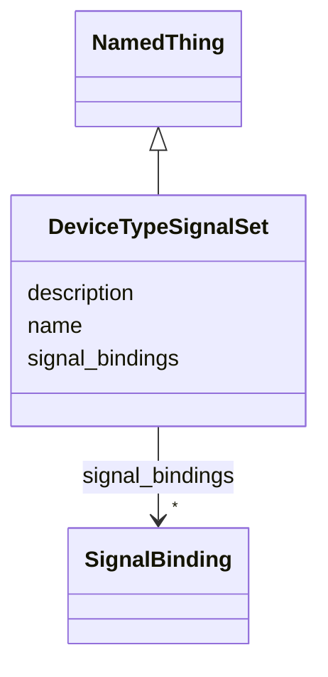

# Class: DeviceTypeSignalSet 


_Signal binding set scoped to a device type (e.g. Quadrupole, BPM)._


URI: [narad:DeviceTypeSignalSet](https://w3id.org/narad_linkml/schema/narad/DeviceTypeSignalSet)





## Inheritance
* [NamedThing](NamedThing.md)
    * **DeviceTypeSignalSet**


## Slots

| Name | Cardinality and Range | Description | Inheritance |
| ---  | --- | --- | --- |
| [signal_bindings](signal_bindings.md) | * <br/> [SignalBinding](SignalBinding.md) | Control-system-specific, e | direct |
| [name](name.md) | 1 <br/> [String](String.md) | Human-readable name or local string key for the entity | [NamedThing](NamedThing.md) |
| [description](description.md) | 0..1 <br/> [String](String.md) | Detailed description of the entity | [NamedThing](NamedThing.md) |


## Usages

| used by | used in | type | used |
| ---  | --- | --- | --- |
| [SignalDefinitions](SignalDefinitions.md) | [type_signal_sets](type_signal_sets.md) | range | [DeviceTypeSignalSet](DeviceTypeSignalSet.md) |


## Identifier and Mapping Information


### Schema Source


* from schema: https://w3id.org/narad_linkml/schema/narad/system


## Mappings

| Mapping Type | Mapped Value |
| ---  | ---  |
| self | narad:DeviceTypeSignalSet |
| native | narad:DeviceTypeSignalSet |


## LinkML Source

<!-- TODO: investigate https://stackoverflow.com/questions/37606292/how-to-create-tabbed-code-blocks-in-mkdocs-or-sphinx -->

### Direct

<details>
```yaml
name: DeviceTypeSignalSet
description: Signal binding set scoped to a device type (e.g. Quadrupole, BPM).
from_schema: https://w3id.org/narad_linkml/schema/narad/system
is_a: NamedThing
slots:
- signal_bindings

```
</details>

### Induced

<details>
```yaml
name: DeviceTypeSignalSet
description: Signal binding set scoped to a device type (e.g. Quadrupole, BPM).
from_schema: https://w3id.org/narad_linkml/schema/narad/system
is_a: NamedThing
attributes:
  signal_bindings:
    name: signal_bindings
    description: Control-system-specific, e.g. EPICS, suffix definitions keyed by
      signal name within a device type.
    from_schema: https://w3id.org/narad_linkml/schema/narad/system
    rank: 1000
    alias: signal_bindings
    owner: DeviceTypeSignalSet
    domain_of:
    - DeviceTypeSignalSet
    range: SignalBinding
    multivalued: true
    inlined: true
  name:
    name: name
    description: Human-readable name or local string key for the entity.
    from_schema: https://w3id.org/narad_linkml/schema/narad/system
    rank: 1000
    identifier: true
    alias: name
    owner: DeviceTypeSignalSet
    domain_of:
    - NamedThing
    range: string
    required: true
  description:
    name: description
    description: Detailed description of the entity.
    from_schema: https://w3id.org/narad_linkml/schema/narad/system
    rank: 1000
    alias: description
    owner: DeviceTypeSignalSet
    domain_of:
    - NamedThing
    range: string

```
</details>