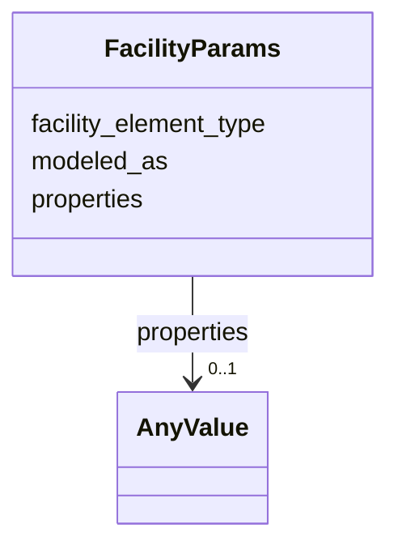

# Class: FacilityParams 


_Facility-specific element parameters: type designation, accelerator model name, and open property map._


URI: [https://w3id.org/narad_linkml/schema/narad/FacilityParams](https://w3id.org/narad_linkml/schema/narad/FacilityParams)





<!-- no inheritance hierarchy -->


## Slots

| Name | Cardinality and Range | Description | Inheritance |
| ---  | --- | --- | --- |
| [facility_element_type](facility_element_type.md) | 0..1 <br/> [String](String.md) | Facility-specific element type designation (e | direct |
| [modeled_as](modeled_as.md) | 0..1 <br/> [String](String.md) | Accelerator physics code model element type (e | direct |
| [properties](properties.md) | 0..1 <br/> [AnyValue](AnyValue.md) | Open-ended key-value property map for element-specific parameters | direct |


## Usages

| used by | used in | type | used |
| ---  | --- | --- | --- |
| [BeamlineElement](BeamlineElement.md) | [facility_params](facility_params.md) | range | [FacilityParams](FacilityParams.md) |


## Identifier and Mapping Information


### Schema Source


* from schema: https://w3id.org/narad_linkml/schema/narad/


## Mappings

| Mapping Type | Mapped Value |
| ---  | ---  |
| self | https://w3id.org/narad_linkml/schema/narad/FacilityParams |
| native | https://w3id.org/narad_linkml/schema/narad/FacilityParams |


## LinkML Source

<!-- TODO: investigate https://stackoverflow.com/questions/37606292/how-to-create-tabbed-code-blocks-in-mkdocs-or-sphinx -->

### Direct

<details>
```yaml
name: FacilityParams
description: 'Facility-specific element parameters: type designation, accelerator
  model name, and open property map.'
from_schema: https://w3id.org/narad_linkml/schema/narad/
slots:
- facility_element_type
- modeled_as
- properties

```
</details>

### Induced

<details>
```yaml
name: FacilityParams
description: 'Facility-specific element parameters: type designation, accelerator
  model name, and open property map.'
from_schema: https://w3id.org/narad_linkml/schema/narad/
attributes:
  facility_element_type:
    name: facility_element_type
    description: Facility-specific element type designation (e.g. WarmCavity, QW,
      HCorrector). named facility_element_type here to avoid conflict with the LinkML
      metamodel 'type' designator used for polymorphic class selection.
    from_schema: https://w3id.org/narad_linkml/schema/narad/
    aliases:
    - type
    rank: 1000
    alias: facility_element_type
    owner: FacilityParams
    domain_of:
    - FacilityParams
    range: string
  modeled_as:
    name: modeled_as
    description: Accelerator physics code model element type (e.g. RFCA, KQUAD, HKICK).
    from_schema: https://w3id.org/narad_linkml/schema/narad/
    rank: 1000
    alias: modeled_as
    owner: FacilityParams
    domain_of:
    - FacilityParams
    range: string
  properties:
    name: properties
    description: Open-ended key-value property map for element-specific parameters.
    from_schema: https://w3id.org/narad_linkml/schema/narad/
    rank: 1000
    alias: properties
    owner: FacilityParams
    domain_of:
    - FacilityParams
    range: AnyValue

```
</details>