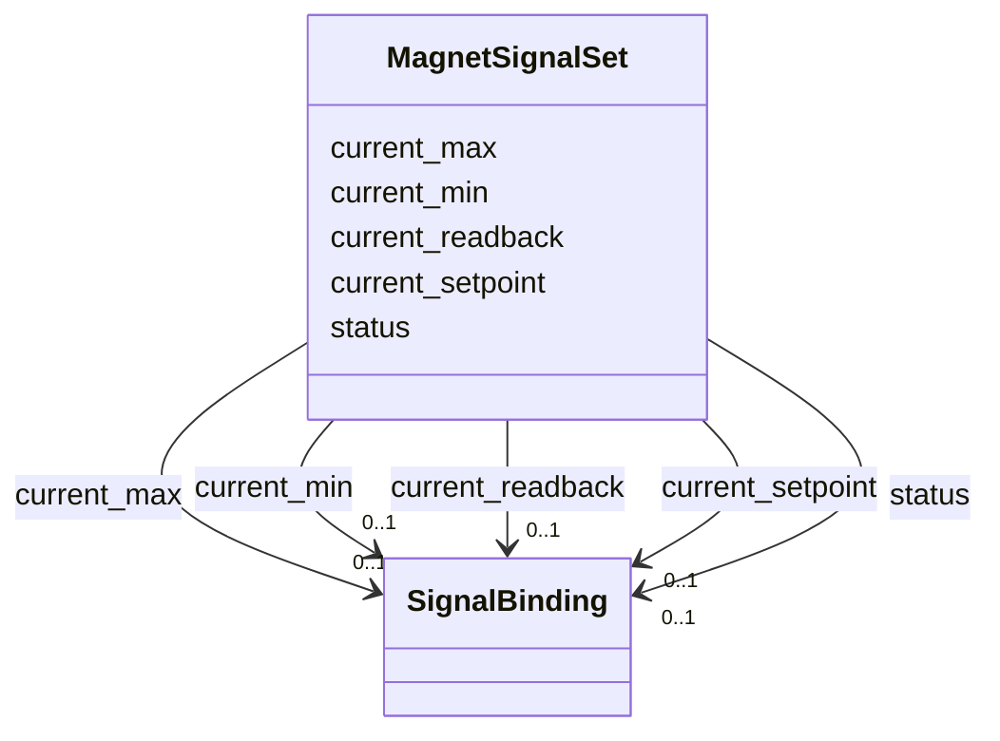

# Class: MagnetSignalSet 


_Shared magnet signal bindings._


URI: [narad:MagnetSignalSet](https://w3id.org/narad_linkml/schema/narad/MagnetSignalSet)





<!-- no inheritance hierarchy -->


## Slots

| Name | Cardinality and Range | Description | Inheritance |
| ---  | --- | --- | --- |
| [current_setpoint](current_setpoint.md) | 0..1 <br/> [SignalBinding](SignalBinding.md) |  | direct |
| [current_readback](current_readback.md) | 0..1 <br/> [SignalBinding](SignalBinding.md) |  | direct |
| [current_min](current_min.md) | 0..1 <br/> [SignalBinding](SignalBinding.md) |  | direct |
| [current_max](current_max.md) | 0..1 <br/> [SignalBinding](SignalBinding.md) |  | direct |
| [status](status.md) | 0..1 <br/> [SignalBinding](SignalBinding.md) |  | direct |


## Usages

| used by | used in | type | used |
| ---  | --- | --- | --- |
| [TypeSignalSet](TypeSignalSet.md) | [magnet_signals](magnet_signals.md) | range | [MagnetSignalSet](MagnetSignalSet.md) |


## Identifier and Mapping Information


### Schema Source


* from schema: https://w3id.org/narad_linkml/schema/narad/system


## Mappings

| Mapping Type | Mapped Value |
| ---  | ---  |
| self | narad:MagnetSignalSet |
| native | narad:MagnetSignalSet |


## LinkML Source

<!-- TODO: investigate https://stackoverflow.com/questions/37606292/how-to-create-tabbed-code-blocks-in-mkdocs-or-sphinx -->

### Direct

<details>
```yaml
name: MagnetSignalSet
description: Shared magnet signal bindings.
from_schema: https://w3id.org/narad_linkml/schema/narad/system
slots:
- current_setpoint
- current_readback
- current_min
- current_max
- status

```
</details>

### Induced

<details>
```yaml
name: MagnetSignalSet
description: Shared magnet signal bindings.
from_schema: https://w3id.org/narad_linkml/schema/narad/system
attributes:
  current_setpoint:
    name: current_setpoint
    from_schema: https://w3id.org/narad_linkml/schema/narad/system
    rank: 1000
    alias: current_setpoint
    owner: MagnetSignalSet
    domain_of:
    - MagnetSignalSet
    range: SignalBinding
    inlined: true
  current_readback:
    name: current_readback
    from_schema: https://w3id.org/narad_linkml/schema/narad/system
    rank: 1000
    alias: current_readback
    owner: MagnetSignalSet
    domain_of:
    - MagnetSignalSet
    range: SignalBinding
    inlined: true
  current_min:
    name: current_min
    from_schema: https://w3id.org/narad_linkml/schema/narad/system
    rank: 1000
    alias: current_min
    owner: MagnetSignalSet
    domain_of:
    - MagnetSignalSet
    range: SignalBinding
    inlined: true
  current_max:
    name: current_max
    from_schema: https://w3id.org/narad_linkml/schema/narad/system
    rank: 1000
    alias: current_max
    owner: MagnetSignalSet
    domain_of:
    - MagnetSignalSet
    range: SignalBinding
    inlined: true
  status:
    name: status
    from_schema: https://w3id.org/narad_linkml/schema/narad/system
    rank: 1000
    alias: status
    owner: MagnetSignalSet
    domain_of:
    - MagnetSignalSet
    - BPMSignalSet
    - RFCavitySignalSet
    range: SignalBinding
    inlined: true

```
</details>