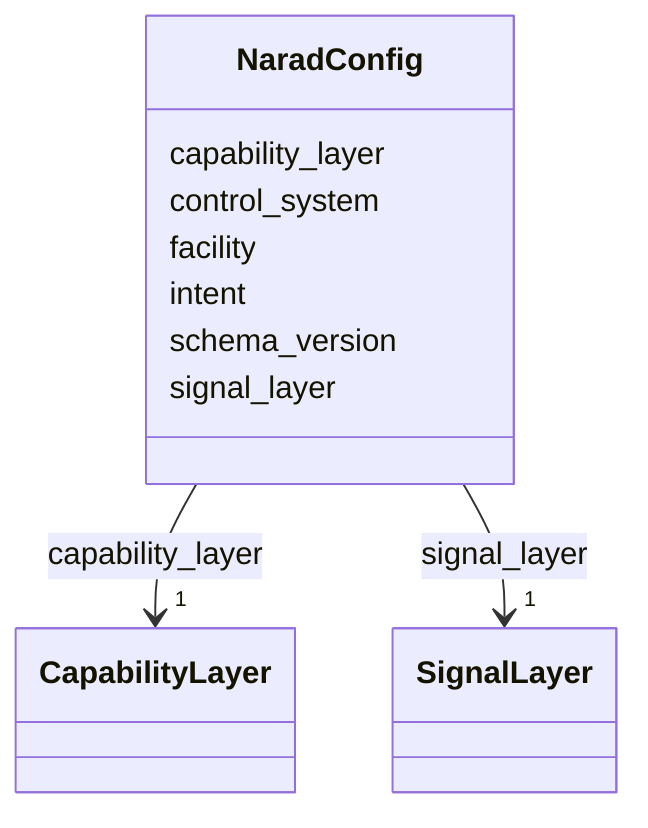

# Class: NaradConfig 


_A top-level NARAD-system container for the: capability layer + signal layer._


URI: [narad:NaradConfig](https://w3id.org/narad_linkml/schema/narad/NaradConfig)





<!-- no inheritance hierarchy -->


## Slots

| Name | Cardinality and Range | Description | Inheritance |
| ---  | --- | --- | --- |
| [schema_version](schema_version.md) | 1 <br/> [String](String.md) | Version of the NARAD schema used in this document | direct |
| [intent](intent.md) | 0..1 <br/> [String](String.md) | A human-readable statement of the intended use or purpose of this NARAD confi... | direct |
| [capability_layer](capability_layer.md) | 1 <br/> [CapabilityLayer](CapabilityLayer.md) | Capability-layer container for control profile families | direct |
| [facility](facility.md) | 1 <br/> [String](String.md) | Identifier of the facility this configuration describes | direct |
| [control_system](control_system.md) | 1 <br/> [String](String.md) | Identifier of the control system (e | direct |
| [signal_layer](signal_layer.md) | 1 <br/> [SignalLayer](SignalLayer.md) | Signal-layer container for facility-specific signal bindings | direct |


## Usages

| used by | used in | type | used |
| ---  | --- | --- | --- |
| [NaradModel](NaradModel.md) | [narad_config](narad_config.md) | range | [NaradConfig](NaradConfig.md) |


## Identifier and Mapping Information


### Schema Source


* from schema: https://w3id.org/narad_linkml/schema/narad/system


## Mappings

| Mapping Type | Mapped Value |
| ---  | ---  |
| self | narad:NaradConfig |
| native | narad:NaradConfig |
| broad | ssn:System |


## LinkML Source

<!-- TODO: investigate https://stackoverflow.com/questions/37606292/how-to-create-tabbed-code-blocks-in-mkdocs-or-sphinx -->

### Direct

<details>
```yaml
name: NaradConfig
description: 'A top-level NARAD-system container for the: capability layer + signal
  layer.'
from_schema: https://w3id.org/narad_linkml/schema/narad/system
broad_mappings:
- ssn:System
slots:
- schema_version
- intent
- capability_layer
- facility
- control_system
- signal_layer
slot_usage:
  schema_version:
    name: schema_version
    description: Version of the NARAD schema used in this document.
    range: string
    required: true
  facility:
    name: facility
    description: Identifier of the facility this configuration describes.
    range: string
    required: true
  control_system:
    name: control_system
    description: Identifier of the control system (e.g. epics) this configuration
      describes.
    range: string
    required: true
  capability_layer:
    name: capability_layer
    description: Capability-layer container for control profile families.
    range: CapabilityLayer
    required: true
    inlined: false
  signal_layer:
    name: signal_layer
    description: Signal-layer container for facility-specific signal bindings.
    range: SignalLayer
    required: true
    inlined: false

```
</details>

### Induced

<details>
```yaml
name: NaradConfig
description: 'A top-level NARAD-system container for the: capability layer + signal
  layer.'
from_schema: https://w3id.org/narad_linkml/schema/narad/system
broad_mappings:
- ssn:System
slot_usage:
  schema_version:
    name: schema_version
    description: Version of the NARAD schema used in this document.
    range: string
    required: true
  facility:
    name: facility
    description: Identifier of the facility this configuration describes.
    range: string
    required: true
  control_system:
    name: control_system
    description: Identifier of the control system (e.g. epics) this configuration
      describes.
    range: string
    required: true
  capability_layer:
    name: capability_layer
    description: Capability-layer container for control profile families.
    range: CapabilityLayer
    required: true
    inlined: false
  signal_layer:
    name: signal_layer
    description: Signal-layer container for facility-specific signal bindings.
    range: SignalLayer
    required: true
    inlined: false
attributes:
  schema_version:
    name: schema_version
    description: Version of the NARAD schema used in this document.
    from_schema: https://w3id.org/narad_linkml/schema/narad/system
    rank: 1000
    alias: schema_version
    owner: NaradConfig
    domain_of:
    - NaradConfig
    range: string
    required: true
  intent:
    name: intent
    description: A human-readable statement of the intended use or purpose of this
      NARAD configuration.
    from_schema: https://w3id.org/narad_linkml/schema/narad/system
    rank: 1000
    alias: intent
    owner: NaradConfig
    domain_of:
    - NaradConfig
    range: string
  capability_layer:
    name: capability_layer
    description: Capability-layer container for control profile families.
    from_schema: https://w3id.org/narad_linkml/schema/narad/system
    rank: 1000
    alias: capability_layer
    owner: NaradConfig
    domain_of:
    - NaradConfig
    range: CapabilityLayer
    required: true
    inlined: false
  facility:
    name: facility
    description: Identifier of the facility this configuration describes.
    from_schema: https://w3id.org/narad_linkml/schema/narad/system
    rank: 1000
    alias: facility
    owner: NaradConfig
    domain_of:
    - NaradConfig
    range: string
    required: true
  control_system:
    name: control_system
    description: Identifier of the control system (e.g. epics) this configuration
      describes.
    from_schema: https://w3id.org/narad_linkml/schema/narad/system
    rank: 1000
    alias: control_system
    owner: NaradConfig
    domain_of:
    - NaradConfig
    - FacilityConfig
    range: string
    required: true
  signal_layer:
    name: signal_layer
    description: Signal-layer container for facility-specific signal bindings.
    from_schema: https://w3id.org/narad_linkml/schema/narad/system
    rank: 1000
    alias: signal_layer
    owner: NaradConfig
    domain_of:
    - NaradConfig
    range: SignalLayer
    required: true
    inlined: false

```
</details>