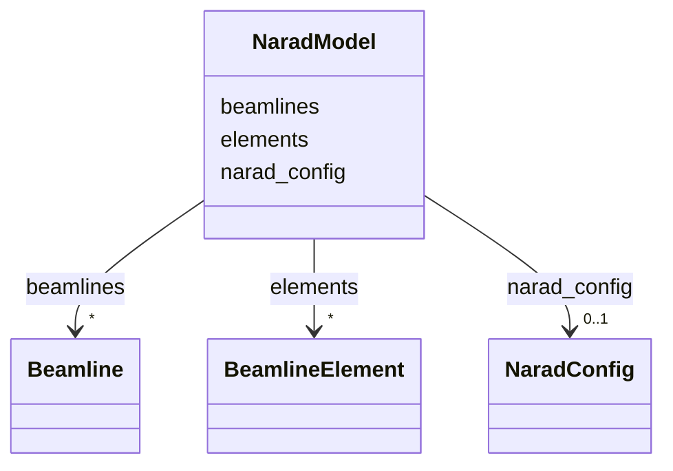

# Class: NaradModel 


_Top-level NARAD document container._


URI: [narad:NaradModel](https://w3id.org/narad_linkml/schema/narad/NaradModel)





<!-- no inheritance hierarchy -->


## Slots

| Name | Cardinality and Range | Description | Inheritance |
| ---  | --- | --- | --- |
| [narad_config](narad_config.md) | 0..1 <br/> [NaradConfig](NaradConfig.md) | Top-level NARAD configuration block (capability_layer + signal_layer) | direct |
| [beamlines](beamlines.md) | * <br/> [Beamline](Beamline.md) | Ordered beamline definitions keyed by beamline name | direct |
| [elements](elements.md) | * <br/> [BeamlineElement](BeamlineElement.md) | Beamline element definitions referenced by name from beamline sequences | direct |


## Identifier and Mapping Information


### Schema Source


* from schema: https://w3id.org/narad_linkml/schema/narad/system


## Mappings

| Mapping Type | Mapped Value |
| ---  | ---  |
| self | narad:NaradModel |
| native | narad:NaradModel |


## LinkML Source

<!-- TODO: investigate https://stackoverflow.com/questions/37606292/how-to-create-tabbed-code-blocks-in-mkdocs-or-sphinx -->

### Direct

<details>
```yaml
name: NaradModel
description: Top-level NARAD document container.
from_schema: https://w3id.org/narad_linkml/schema/narad/system
slots:
- narad_config
- beamlines
- elements
tree_root: true

```
</details>

### Induced

<details>
```yaml
name: NaradModel
description: Top-level NARAD document container.
from_schema: https://w3id.org/narad_linkml/schema/narad/system
attributes:
  narad_config:
    name: narad_config
    description: Top-level NARAD configuration block (capability_layer + signal_layer).
    from_schema: https://w3id.org/narad_linkml/schema/narad/system
    aliases:
    - narad
    rank: 1000
    alias: narad_config
    owner: NaradModel
    domain_of:
    - NaradModel
    range: NaradConfig
    inlined: true
  beamlines:
    name: beamlines
    description: Ordered beamline definitions keyed by beamline name.
    from_schema: https://w3id.org/narad_linkml/schema/narad/system
    rank: 1000
    alias: beamlines
    owner: NaradModel
    domain_of:
    - NaradModel
    range: Beamline
    multivalued: true
    inlined: true
  elements:
    name: elements
    description: Beamline element definitions referenced by name from beamline sequences.
    from_schema: https://w3id.org/narad_linkml/schema/narad/system
    rank: 1000
    alias: elements
    owner: NaradModel
    domain_of:
    - NaradModel
    range: BeamlineElement
    multivalued: true
    inlined: true
    inlined_as_list: true
tree_root: true

```
</details>