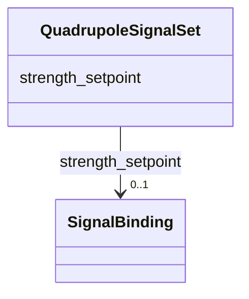

# Class: QuadrupoleSignalSet 


_Quadrupole-specific signal bindings._


URI: [narad:QuadrupoleSignalSet](https://w3id.org/narad_linkml/schema/narad/QuadrupoleSignalSet)





<!-- no inheritance hierarchy -->


## Slots

| Name | Cardinality and Range | Description | Inheritance |
| ---  | --- | --- | --- |
| [strength_setpoint](strength_setpoint.md) | 0..1 <br/> [SignalBinding](SignalBinding.md) |  | direct |


## Usages

| used by | used in | type | used |
| ---  | --- | --- | --- |
| [TypeSignalSet](TypeSignalSet.md) | [quadrupole_signals](quadrupole_signals.md) | range | [QuadrupoleSignalSet](QuadrupoleSignalSet.md) |


## Identifier and Mapping Information


### Schema Source


* from schema: https://w3id.org/narad_linkml/schema/narad/system


## Mappings

| Mapping Type | Mapped Value |
| ---  | ---  |
| self | narad:QuadrupoleSignalSet |
| native | narad:QuadrupoleSignalSet |


## LinkML Source

<!-- TODO: investigate https://stackoverflow.com/questions/37606292/how-to-create-tabbed-code-blocks-in-mkdocs-or-sphinx -->

### Direct

<details>
```yaml
name: QuadrupoleSignalSet
description: Quadrupole-specific signal bindings.
from_schema: https://w3id.org/narad_linkml/schema/narad/system
slots:
- strength_setpoint

```
</details>

### Induced

<details>
```yaml
name: QuadrupoleSignalSet
description: Quadrupole-specific signal bindings.
from_schema: https://w3id.org/narad_linkml/schema/narad/system
attributes:
  strength_setpoint:
    name: strength_setpoint
    from_schema: https://w3id.org/narad_linkml/schema/narad/system
    rank: 1000
    alias: strength_setpoint
    owner: QuadrupoleSignalSet
    domain_of:
    - QuadrupoleSignalSet
    range: SignalBinding
    inlined: true

```
</details>