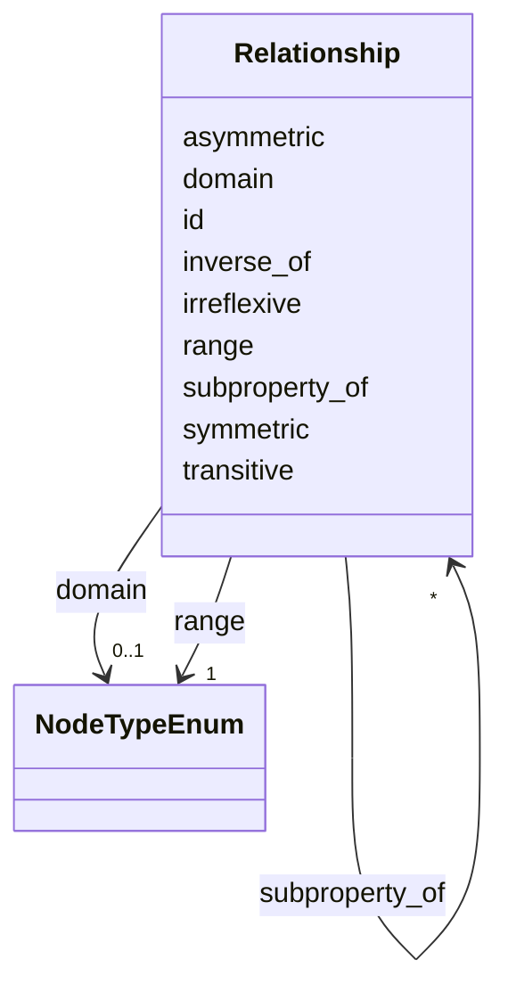

# Class: Relationship 


_A directed edge type in the NARAD graph projection, modelled after the OBO Relation Ontology (RO) ObjectProperty metamodel. Each relationship carries an identifier, human-readable label, natural-language description, and explicit domain/range node-type constraints._


URI: [owl:ObjectProperty](http://www.w3.org/2002/07/owl#ObjectProperty)





<!-- no inheritance hierarchy -->


## Slots

| Name | Cardinality and Range | Description | Inheritance |
| ---  | --- | --- | --- |
| [id](id.md) | 1 <br/> [String](String.md) | Unique identifier for the entity | direct |
| [domain](domain.md) | 0..1 <br/> [NodeTypeEnum](NodeTypeEnum.md) | The node type that can appear as the subject (source) of this relationship | direct |
| [range](range.md) | 1 <br/> [NodeTypeEnum](NodeTypeEnum.md) | The node type that can appear as the object (target) of this relationship | direct |
| [subproperty_of](subproperty_of.md) | * <br/> [Relationship](Relationship.md) | Parent relationships of which this is a more specific sub-relation | direct |
| [inverse_of](inverse_of.md) | 0..1 <br/> [Relationship](Relationship.md) | The inverse relationship, if any | direct |
| [symmetric](symmetric.md) | 0..1 <br/> [Boolean](Boolean.md) | True if the relation is symmetric: if A rel B then B rel A | direct |
| [transitive](transitive.md) | 0..1 <br/> [Boolean](Boolean.md) | True if the relation is transitive: if A rel B and B rel C then A rel C | direct |
| [asymmetric](asymmetric.md) | 0..1 <br/> [Boolean](Boolean.md) | True if the relation is asymmetric: if A rel B then NOT B rel A | direct |
| [irreflexive](irreflexive.md) | 0..1 <br/> [Boolean](Boolean.md) | True if no entity can stand in this relation to itself | direct |


## Usages

| used by | used in | type | used |
| ---  | --- | --- | --- |
| [GraphProjection](GraphProjection.md) | [relationships](relationships.md) | range | [Relationship](Relationship.md) |
| [Relationship](Relationship.md) | [subproperty_of](subproperty_of.md) | range | [Relationship](Relationship.md) |
| [Relationship](Relationship.md) | [inverse_of](inverse_of.md) | range | [Relationship](Relationship.md) |


## Identifier and Mapping Information


### Schema Source


* from schema: https://w3id.org/narad_linkml/schema/narad/


## Mappings

| Mapping Type | Mapped Value |
| ---  | ---  |
| self | owl:ObjectProperty |
| native | https://w3id.org/narad_linkml/schema/narad/Relationship |


## LinkML Source

<!-- TODO: investigate https://stackoverflow.com/questions/37606292/how-to-create-tabbed-code-blocks-in-mkdocs-or-sphinx -->

### Direct

<details>
```yaml
name: Relationship
description: A directed edge type in the NARAD graph projection, modelled after the
  OBO Relation Ontology (RO) ObjectProperty metamodel. Each relationship carries an
  identifier, human-readable label, natural-language description, and explicit domain/range
  node-type constraints.
from_schema: https://w3id.org/narad_linkml/schema/narad/
slots:
- id
- domain
- range
- subproperty_of
- inverse_of
- symmetric
- transitive
- asymmetric
- irreflexive
slot_usage:
  id:
    name: id
    range: string
    required: true
  range:
    name: range
    range: NodeTypeEnum
    required: true
  range_target:
    name: range_target
    range: string
    required: true
class_uri: owl:ObjectProperty

```
</details>

### Induced

<details>
```yaml
name: Relationship
description: A directed edge type in the NARAD graph projection, modelled after the
  OBO Relation Ontology (RO) ObjectProperty metamodel. Each relationship carries an
  identifier, human-readable label, natural-language description, and explicit domain/range
  node-type constraints.
from_schema: https://w3id.org/narad_linkml/schema/narad/
slot_usage:
  id:
    name: id
    range: string
    required: true
  range:
    name: range
    range: NodeTypeEnum
    required: true
  range_target:
    name: range_target
    range: string
    required: true
attributes:
  id:
    name: id
    description: Unique identifier for the entity.
    from_schema: https://w3id.org/narad_linkml/schema/narad/
    rank: 1000
    identifier: true
    alias: id
    owner: Relationship
    domain_of:
    - TypeSpecificCapability
    - Relationship
    range: string
    required: true
  domain:
    name: domain
    description: The node type that can appear as the subject (source) of this relationship.
    from_schema: https://w3id.org/narad_linkml/schema/narad/
    rank: 1000
    alias: domain
    owner: Relationship
    domain_of:
    - Relationship
    range: NodeTypeEnum
  range:
    name: range
    description: The node type that can appear as the object (target) of this relationship.
    from_schema: https://w3id.org/narad_linkml/schema/narad/
    rank: 1000
    alias: range
    owner: Relationship
    domain_of:
    - Relationship
    range: NodeTypeEnum
    required: true
  subproperty_of:
    name: subproperty_of
    description: Parent relationships of which this is a more specific sub-relation.
    from_schema: https://w3id.org/narad_linkml/schema/narad/
    rank: 1000
    alias: subproperty_of
    owner: Relationship
    domain_of:
    - Relationship
    range: Relationship
    multivalued: true
    inlined: false
  inverse_of:
    name: inverse_of
    description: The inverse relationship, if any.
    from_schema: https://w3id.org/narad_linkml/schema/narad/
    rank: 1000
    alias: inverse_of
    owner: Relationship
    domain_of:
    - Relationship
    range: Relationship
    inlined: false
  symmetric:
    name: symmetric
    description: 'True if the relation is symmetric: if A rel B then B rel A.'
    from_schema: https://w3id.org/narad_linkml/schema/narad/
    rank: 1000
    alias: symmetric
    owner: Relationship
    domain_of:
    - Relationship
    range: boolean
  transitive:
    name: transitive
    description: 'True if the relation is transitive: if A rel B and B rel C then
      A rel C.'
    from_schema: https://w3id.org/narad_linkml/schema/narad/
    rank: 1000
    alias: transitive
    owner: Relationship
    domain_of:
    - Relationship
    range: boolean
  asymmetric:
    name: asymmetric
    description: 'True if the relation is asymmetric: if A rel B then NOT B rel A.'
    from_schema: https://w3id.org/narad_linkml/schema/narad/
    rank: 1000
    alias: asymmetric
    owner: Relationship
    domain_of:
    - Relationship
    range: boolean
  irreflexive:
    name: irreflexive
    description: True if no entity can stand in this relation to itself.
    from_schema: https://w3id.org/narad_linkml/schema/narad/
    rank: 1000
    alias: irreflexive
    owner: Relationship
    domain_of:
    - Relationship
    range: boolean
class_uri: owl:ObjectProperty

```
</details>