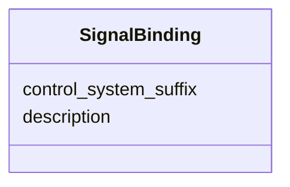

# Class: SignalBinding 


_A named control system suffix definition for one semantic signal. The suffix is used within in a template naming convention to construct the full control system PV name for a given device instance._


URI: [narad:SignalBinding](https://w3id.org/narad_linkml/schema/narad/SignalBinding)





<!-- no inheritance hierarchy -->


## Slots

| Name | Cardinality and Range | Description | Inheritance |
| ---  | --- | --- | --- |
| [description](description.md) | 0..1 <br/> [String](String.md) | Detailed description of the entity | direct |
| [control_system_suffix](control_system_suffix.md) | 0..1 <br/> [String](String.md) | Facility-specific control-system (e | direct |


## Usages

| used by | used in | type | used |
| ---  | --- | --- | --- |
| [MagnetSignalSet](MagnetSignalSet.md) | [current_setpoint](current_setpoint.md) | range | [SignalBinding](SignalBinding.md) |
| [MagnetSignalSet](MagnetSignalSet.md) | [current_readback](current_readback.md) | range | [SignalBinding](SignalBinding.md) |
| [MagnetSignalSet](MagnetSignalSet.md) | [current_min](current_min.md) | range | [SignalBinding](SignalBinding.md) |
| [MagnetSignalSet](MagnetSignalSet.md) | [current_max](current_max.md) | range | [SignalBinding](SignalBinding.md) |
| [MagnetSignalSet](MagnetSignalSet.md) | [status](status.md) | range | [SignalBinding](SignalBinding.md) |
| [QuadrupoleSignalSet](QuadrupoleSignalSet.md) | [strength_setpoint](strength_setpoint.md) | range | [SignalBinding](SignalBinding.md) |
| [CorrectorSignalSet](CorrectorSignalSet.md) | [kick_setpoint](kick_setpoint.md) | range | [SignalBinding](SignalBinding.md) |
| [DipoleSignalSet](DipoleSignalSet.md) | [field_setpoint](field_setpoint.md) | range | [SignalBinding](SignalBinding.md) |
| [BPMSignalSet](BPMSignalSet.md) | [horizontal_beam_position](horizontal_beam_position.md) | range | [SignalBinding](SignalBinding.md) |
| [BPMSignalSet](BPMSignalSet.md) | [vertical_beam_position](vertical_beam_position.md) | range | [SignalBinding](SignalBinding.md) |
| [BPMSignalSet](BPMSignalSet.md) | [status](status.md) | range | [SignalBinding](SignalBinding.md) |
| [RFCavitySignalSet](RFCavitySignalSet.md) | [gradient_setpoint](gradient_setpoint.md) | range | [SignalBinding](SignalBinding.md) |
| [RFCavitySignalSet](RFCavitySignalSet.md) | [gradient_readback](gradient_readback.md) | range | [SignalBinding](SignalBinding.md) |
| [RFCavitySignalSet](RFCavitySignalSet.md) | [status](status.md) | range | [SignalBinding](SignalBinding.md) |


## Identifier and Mapping Information


### Schema Source


* from schema: https://w3id.org/narad_linkml/schema/narad/system


## Mappings

| Mapping Type | Mapped Value |
| ---  | ---  |
| self | narad:SignalBinding |
| native | narad:SignalBinding |


## LinkML Source

<!-- TODO: investigate https://stackoverflow.com/questions/37606292/how-to-create-tabbed-code-blocks-in-mkdocs-or-sphinx -->

### Direct

<details>
```yaml
name: SignalBinding
description: A named control system suffix definition for one semantic signal. The
  suffix is used within in a template naming convention to construct the full control
  system PV name for a given device instance.
from_schema: https://w3id.org/narad_linkml/schema/narad/system
slots:
- description
- control_system_suffix

```
</details>

### Induced

<details>
```yaml
name: SignalBinding
description: A named control system suffix definition for one semantic signal. The
  suffix is used within in a template naming convention to construct the full control
  system PV name for a given device instance.
from_schema: https://w3id.org/narad_linkml/schema/narad/system
attributes:
  description:
    name: description
    description: Detailed description of the entity.
    from_schema: https://w3id.org/narad_linkml/schema/narad/system
    rank: 1000
    alias: description
    owner: SignalBinding
    domain_of:
    - NamedThing
    - SignalBinding
    range: string
  control_system_suffix:
    name: control_system_suffix
    description: 'Facility-specific control-system (e.g. EPICS) naming suffix used
      to derive or interpret the signal binding, e.g. .S, M, :GSET.

      '
    from_schema: https://w3id.org/narad_linkml/schema/narad/system
    rank: 1000
    alias: control_system_suffix
    owner: SignalBinding
    domain_of:
    - SignalBinding
    range: string

```
</details>