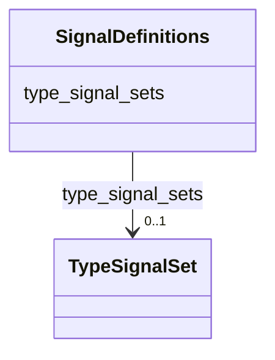

# Class: SignalDefinitions 


_Control system signal suffix templates keyed by device type or device domain. Domain-level keys (e.g. Magnet, RFCavity) cover signals shared across all types in that domain; device-type keys are type-specific._


URI: [narad:SignalDefinitions](https://w3id.org/narad_linkml/schema/narad/SignalDefinitions)





<!-- no inheritance hierarchy -->


## Slots

| Name | Cardinality and Range | Description | Inheritance |
| ---  | --- | --- | --- |
| [type_signal_sets](type_signal_sets.md) | 0..1 <br/> [TypeSignalSet](TypeSignalSet.md) | Signal suffix groups keyed by device type or device domain name | direct |


## Usages

| used by | used in | type | used |
| ---  | --- | --- | --- |
| [FacilityConfig](FacilityConfig.md) | [signal_definitions](signal_definitions.md) | range | [SignalDefinitions](SignalDefinitions.md) |


## Identifier and Mapping Information


### Schema Source


* from schema: https://w3id.org/narad_linkml/schema/narad/system


## Mappings

| Mapping Type | Mapped Value |
| ---  | ---  |
| self | narad:SignalDefinitions |
| native | narad:SignalDefinitions |


## LinkML Source

<!-- TODO: investigate https://stackoverflow.com/questions/37606292/how-to-create-tabbed-code-blocks-in-mkdocs-or-sphinx -->

### Direct

<details>
```yaml
name: SignalDefinitions
description: Control system signal suffix templates keyed by device type or device
  domain. Domain-level keys (e.g. Magnet, RFCavity) cover signals shared across all
  types in that domain; device-type keys are type-specific.
from_schema: https://w3id.org/narad_linkml/schema/narad/system
slots:
- type_signal_sets

```
</details>

### Induced

<details>
```yaml
name: SignalDefinitions
description: Control system signal suffix templates keyed by device type or device
  domain. Domain-level keys (e.g. Magnet, RFCavity) cover signals shared across all
  types in that domain; device-type keys are type-specific.
from_schema: https://w3id.org/narad_linkml/schema/narad/system
attributes:
  type_signal_sets:
    name: type_signal_sets
    description: Signal suffix groups keyed by device type or device domain name.
      Domain-level keys cover signals shared across all types in that domain; device-type
      keys are type-specific.
    from_schema: https://w3id.org/narad_linkml/schema/narad/system
    rank: 1000
    alias: type_signal_sets
    owner: SignalDefinitions
    domain_of:
    - SignalDefinitions
    range: TypeSignalSet
    multivalued: false
    inlined: true

```
</details>