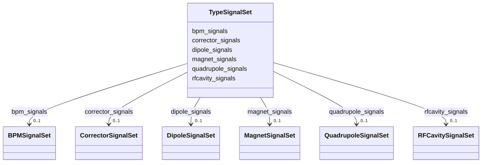

# Class: TypeSignalSet 


_Explicit signal binding groups keyed by device domain or device type._


URI: [narad:TypeSignalSet](https://w3id.org/narad_linkml/schema/narad/TypeSignalSet)





<!-- no inheritance hierarchy -->


## Slots

| Name | Cardinality and Range | Description | Inheritance |
| ---  | --- | --- | --- |
| [magnet_signals](magnet_signals.md) | 0..1 <br/> [MagnetSignalSet](MagnetSignalSet.md) | Shared magnet signal bindings | direct |
| [quadrupole_signals](quadrupole_signals.md) | 0..1 <br/> [QuadrupoleSignalSet](QuadrupoleSignalSet.md) | Quadrupole-specific signal bindings | direct |
| [corrector_signals](corrector_signals.md) | 0..1 <br/> [CorrectorSignalSet](CorrectorSignalSet.md) | Corrector-specific signal bindings | direct |
| [dipole_signals](dipole_signals.md) | 0..1 <br/> [DipoleSignalSet](DipoleSignalSet.md) | Dipole-specific signal bindings | direct |
| [bpm_signals](bpm_signals.md) | 0..1 <br/> [BPMSignalSet](BPMSignalSet.md) | BPM-specific signal bindings | direct |
| [rfcavity_signals](rfcavity_signals.md) | 0..1 <br/> [RFCavitySignalSet](RFCavitySignalSet.md) | RF cavity-specific signal bindings | direct |


## Usages

| used by | used in | type | used |
| ---  | --- | --- | --- |
| [SignalDefinitions](SignalDefinitions.md) | [type_signal_sets](type_signal_sets.md) | range | [TypeSignalSet](TypeSignalSet.md) |


## Identifier and Mapping Information


### Schema Source


* from schema: https://w3id.org/narad_linkml/schema/narad/system


## Mappings

| Mapping Type | Mapped Value |
| ---  | ---  |
| self | narad:TypeSignalSet |
| native | narad:TypeSignalSet |


## LinkML Source

<!-- TODO: investigate https://stackoverflow.com/questions/37606292/how-to-create-tabbed-code-blocks-in-mkdocs-or-sphinx -->

### Direct

<details>
```yaml
name: TypeSignalSet
description: Explicit signal binding groups keyed by device domain or device type.
from_schema: https://w3id.org/narad_linkml/schema/narad/system
slots:
- magnet_signals
- quadrupole_signals
- corrector_signals
- dipole_signals
- bpm_signals
- rfcavity_signals

```
</details>

### Induced

<details>
```yaml
name: TypeSignalSet
description: Explicit signal binding groups keyed by device domain or device type.
from_schema: https://w3id.org/narad_linkml/schema/narad/system
attributes:
  magnet_signals:
    name: magnet_signals
    description: Shared magnet signal bindings.
    from_schema: https://w3id.org/narad_linkml/schema/narad/system
    rank: 1000
    alias: magnet_signals
    owner: TypeSignalSet
    domain_of:
    - TypeSignalSet
    range: MagnetSignalSet
    inlined: true
  quadrupole_signals:
    name: quadrupole_signals
    description: Quadrupole-specific signal bindings.
    from_schema: https://w3id.org/narad_linkml/schema/narad/system
    rank: 1000
    alias: quadrupole_signals
    owner: TypeSignalSet
    domain_of:
    - TypeSignalSet
    range: QuadrupoleSignalSet
    inlined: true
  corrector_signals:
    name: corrector_signals
    description: Corrector-specific signal bindings.
    from_schema: https://w3id.org/narad_linkml/schema/narad/system
    rank: 1000
    alias: corrector_signals
    owner: TypeSignalSet
    domain_of:
    - TypeSignalSet
    range: CorrectorSignalSet
    inlined: true
  dipole_signals:
    name: dipole_signals
    description: Dipole-specific signal bindings.
    from_schema: https://w3id.org/narad_linkml/schema/narad/system
    rank: 1000
    alias: dipole_signals
    owner: TypeSignalSet
    domain_of:
    - TypeSignalSet
    range: DipoleSignalSet
    inlined: true
  bpm_signals:
    name: bpm_signals
    description: BPM-specific signal bindings.
    from_schema: https://w3id.org/narad_linkml/schema/narad/system
    rank: 1000
    alias: bpm_signals
    owner: TypeSignalSet
    domain_of:
    - TypeSignalSet
    range: BPMSignalSet
    inlined: true
  rfcavity_signals:
    name: rfcavity_signals
    description: RF cavity-specific signal bindings.
    from_schema: https://w3id.org/narad_linkml/schema/narad/system
    rank: 1000
    alias: rfcavity_signals
    owner: TypeSignalSet
    domain_of:
    - TypeSignalSet
    range: RFCavitySignalSet
    inlined: true

```
</details>