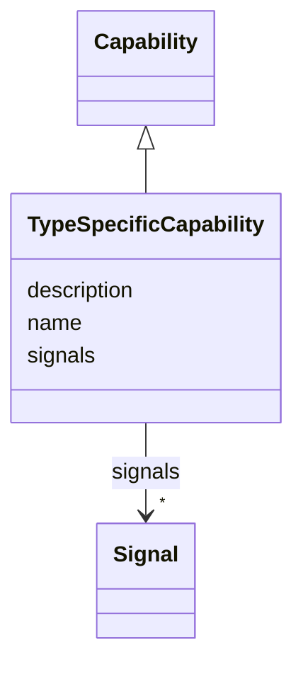

# Class: TypeSpecificCapability 


_An inline capability declared within a device-type profile that extends a generic shared Capability. The explicit link to the shared Capability being extended is given by inherits_from. Adds type-specific signals on top of those already defined in the referenced shared Capability._


URI: [narad:TypeSpecificCapability](https://w3id.org/narad_linkml/schema/narad/TypeSpecificCapability)





## Inheritance
* [NamedThing](NamedThing.md)
    * [Capability](Capability.md)
        * **TypeSpecificCapability**


## Slots

| Name | Cardinality and Range | Description | Inheritance |
| ---  | --- | --- | --- |
| [signals](signals.md) | * <br/> [Signal](Signal.md) | Signals within a capability, keyed by signal name | [Capability](Capability.md) |
| [name](name.md) | 1 <br/> [String](String.md) | Human-readable name or local string key for the entity | [NamedThing](NamedThing.md) |
| [description](description.md) | 0..1 <br/> [String](String.md) | Detailed description of the entity | [NamedThing](NamedThing.md) |


## Usages

| used by | used in | type | used |
| ---  | --- | --- | --- |
| [CapabilityProfile](CapabilityProfile.md) | [type_specific_capabilities](type_specific_capabilities.md) | range | [TypeSpecificCapability](TypeSpecificCapability.md) |


## Identifier and Mapping Information


### Schema Source


* from schema: https://w3id.org/narad_linkml/schema/narad/system


## Mappings

| Mapping Type | Mapped Value |
| ---  | ---  |
| self | narad:TypeSpecificCapability |
| native | narad:TypeSpecificCapability |


## LinkML Source

<!-- TODO: investigate https://stackoverflow.com/questions/37606292/how-to-create-tabbed-code-blocks-in-mkdocs-or-sphinx -->

### Direct

<details>
```yaml
name: TypeSpecificCapability
description: An inline capability declared within a device-type profile that extends
  a generic shared Capability. The explicit link to the shared Capability being extended
  is given by inherits_from. Adds type-specific signals on top of those already defined
  in the referenced shared Capability.
from_schema: https://w3id.org/narad_linkml/schema/narad/system
is_a: Capability

```
</details>

### Induced

<details>
```yaml
name: TypeSpecificCapability
description: An inline capability declared within a device-type profile that extends
  a generic shared Capability. The explicit link to the shared Capability being extended
  is given by inherits_from. Adds type-specific signals on top of those already defined
  in the referenced shared Capability.
from_schema: https://w3id.org/narad_linkml/schema/narad/system
is_a: Capability
attributes:
  signals:
    name: signals
    description: Signals within a capability, keyed by signal name.
    from_schema: https://w3id.org/narad_linkml/schema/narad/system
    rank: 1000
    alias: signals
    owner: TypeSpecificCapability
    domain_of:
    - Capability
    range: Signal
    multivalued: true
    inlined: true
  name:
    name: name
    description: Human-readable name or local string key for the entity.
    from_schema: https://w3id.org/narad_linkml/schema/narad/system
    rank: 1000
    identifier: true
    alias: name
    owner: TypeSpecificCapability
    domain_of:
    - NamedThing
    range: string
    required: true
  description:
    name: description
    description: Detailed description of the entity.
    from_schema: https://w3id.org/narad_linkml/schema/narad/system
    rank: 1000
    alias: description
    owner: TypeSpecificCapability
    domain_of:
    - NamedThing
    - SignalBinding
    range: string

```
</details>